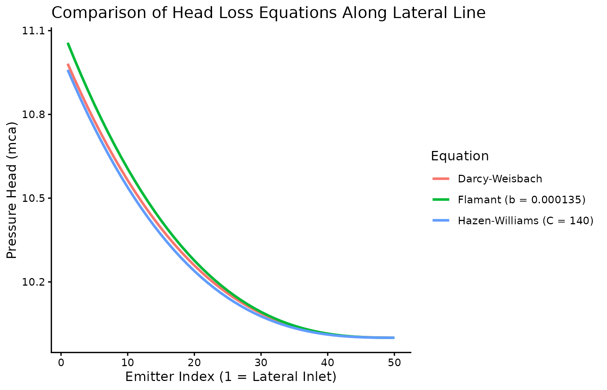

# Pressure and Flow Profile Along Irrigation Lateral Lines

## Overview

In pressurized micro-irrigation systems (drip and micro-sprinkler),
spatial pressure variation along a lateral pipe directly governs water
application uniformity. Because discharge decreases stepwise at each
emitter outlet, friction head loss along the lateral is non-linear.

[`calc_backstep()`](https://joaobtj.github.io/irritool/reference/calc_backstep.md)
implements the **backstep numerical procedure**: starting from a known
boundary pressure head at the distal emitter, it steps upstream segment
by segment toward the lateral inlet. You can choose the head loss
equation from the `hf` package via `method` (`"darcy"`, `"flamant"`, or
`"hw"`) and specify the volumetric flow rate unit directly with
`flow_unit` (such as `"m3/s"`, `"L/s"`, or `"L/h"`).

``` r

library(irritool)
library(ggplot2)
```

------------------------------------------------------------------------

## 1. Level Lateral Line (`slope = 0`) and Flow Units (`flow_unit`)

Consider a polyethylene drip lateral with internal diameter
$`D = 0.012\text{ m}`$ ($`12\text{ mm}`$), absolute roughness
$`\varepsilon = 1.5 \times 10^{-6}\text{ m}`$, and $`50`$ emitters
spaced at $`0.30\text{ m}`$ intervals.

Emitter discharge follows $`q = k \cdot H^x`$ with discharge coefficient
$`k = 3.18\text{ L h}^{-1}\text{ mca}^{-x}`$ and exponent $`x = 0.50`$.
By setting `flow_unit = "L/h"`, there is no need to manually convert the
emitter coefficient to $`\text{m}^3\,\text{s}^{-1}`$, and both
`emitter_flow` and `section_flow` are returned directly in
$`\text{L h}^{-1}`$. Assuming a target distal pressure head of
$`10\text{ mca}`$:

``` r

level_profile <- calc_backstep(
  end_pressure = 10,
  diameter = 0.012,
  spacing = 0.30,
  n_emitters = 50,
  slope = 0,
  emitter_coef = 3.18,
  emitter_exp = 0.50,
  method = "darcy",
  flow_unit = "L/h",
  roughness = 1.5e-6
)

head(level_profile)
#> # A tibble: 6 × 5
#>   emitter pressure_head emitter_flow section_flow head_loss
#>     <int>         <dbl>        <dbl>        <dbl>     <dbl>
#> 1       1          11.0         10.5         509.    0.0540
#> 2       2          10.9         10.5         499.    0.0520
#> 3       3          10.9         10.5         488.    0.0501
#> 4       4          10.8         10.5         478.    0.0482
#> 5       5          10.8         10.4         467.    0.0463
#> 6       6          10.7         10.4         457.    0.0445
tail(level_profile)
#> # A tibble: 6 × 5
#>   emitter pressure_head emitter_flow section_flow head_loss
#>     <int>         <dbl>        <dbl>        <dbl>     <dbl>
#> 1      45          10.0         10.1         60.3  0.000843
#> 2      46          10.0         10.1         50.3  0.000674
#> 3      47          10.0         10.1         40.2  0.000506
#> 4      48          10.0         10.1         30.2  0.000337
#> 5      49          10.0         10.1         20.1  0.000169
#> 6      50          10           10.1         10.1  0
```

Inlet operating pressure head and total lateral inlet flow rate are
retrieved from the first row (`emitter == 1`):

``` r

# Required inlet pressure head (mca)
level_profile$pressure_head[1]
#> [1] 10.98152

# Total inlet flow rate (L/h)
level_profile$section_flow[1]
#> [1] 509.4665
```

------------------------------------------------------------------------

## 2. Effect of Terrain Slope (`slope`)

The `slope` parameter specifies elevation change per unit length
($`\text{m m}^{-1}`$):

- **Positive values** (`slope > 0`) represent uphill flow (elevation
  gain toward the distal end).
- **Negative values** (`slope < 0`) represent downhill flow (elevation
  drop toward the distal end).

``` r

uphill_profile <- calc_backstep(
  end_pressure = 10,
  diameter = 0.012,
  spacing = 0.30,
  n_emitters = 50,
  slope = 0.02,
  emitter_coef = 3.18,
  emitter_exp = 0.50,
  flow_unit = "L/h",
  roughness = 1.5e-6
)

downhill_profile <- calc_backstep(
  end_pressure = 10,
  diameter = 0.012,
  spacing = 0.30,
  n_emitters = 50,
  slope = -0.02,
  emitter_coef = 3.18,
  emitter_exp = 0.50,
  flow_unit = "L/h",
  roughness = 1.5e-6
)

comparison_df <- rbind(
  cbind(level_profile, scenario = "Level (0%)"),
  cbind(uphill_profile, scenario = "Uphill (+2%)"),
  cbind(downhill_profile, scenario = "Downhill (-2%)")
)

ggplot(comparison_df, aes(x = emitter, y = pressure_head, color = scenario)) +
  geom_line(linewidth = 1) +
  labs(
    title = "Pressure Head Profile Along Lateral Line",
    x = "Emitter Index (1 = Lateral Inlet)",
    y = "Pressure Head (mca)",
    color = "Slope Scenario"
  ) +
  theme_classic()
```


------------------------------------------------------------------------

## 3. Comparing Head Loss Equations (`method`)

In addition to Darcy-Weisbach (`method = "darcy"`, default),
[`calc_backstep()`](https://joaobtj.github.io/irritool/reference/calc_backstep.md)
supports the Flamant (`method = "flamant"`) and Hazen-Williams
(`method = "hw"`) empirical equations, forwarding equation-specific
parameters (such as `roughness` or `coef`) through `...`:

``` r

flamant_profile <- calc_backstep(
  end_pressure = 10,
  diameter = 0.012,
  spacing = 0.30,
  n_emitters = 50,
  slope = 0,
  emitter_coef = 3.18,
  emitter_exp = 0.50,
  method = "flamant",
  flow_unit = "L/h",
  coef = 0.000135
)

hw_profile <- calc_backstep(
  end_pressure = 10,
  diameter = 0.012,
  spacing = 0.30,
  n_emitters = 50,
  slope = 0,
  emitter_coef = 3.18,
  emitter_exp = 0.50,
  method = "hw",
  flow_unit = "L/h",
  coef = 140
)

methods_df <- rbind(
  cbind(level_profile, method = "Darcy-Weisbach"),
  cbind(flamant_profile, method = "Flamant (b = 0.000135)"),
  cbind(hw_profile, method = "Hazen-Williams (C = 140)")
)

ggplot(methods_df, aes(x = emitter, y = pressure_head, color = method)) +
  geom_line(linewidth = 1) +
  labs(
    title = "Comparison of Head Loss Equations Along Lateral Line",
    x = "Emitter Index (1 = Lateral Inlet)",
    y = "Pressure Head (mca)",
    color = "Equation"
  ) +
  theme_classic()
```


