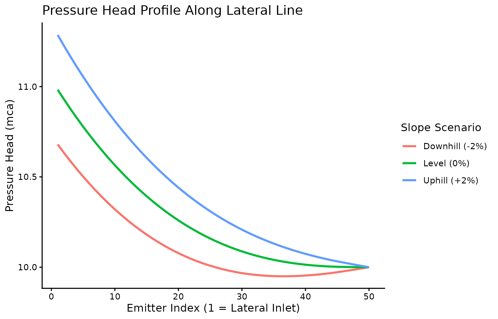

# Pressure and Flow Profile Along Irrigation Lateral Lines

## Overview

In pressurized micro-irrigation systems (drip and micro-sprinkler),
spatial pressure variation along a lateral pipe directly governs water
application uniformity. Because discharge decreases stepwise at each
emitter outlet, friction head loss along the lateral is non-linear.

[`calc_backstep()`](https://joaobtj.github.io/irritool/reference/calc_backstep.md)
implements the **backstep numerical procedure**: starting from a known
boundary pressure head at the distal emitter, it steps upstream segment
by segment toward the lateral inlet, computing Darcy-Weisbach friction
losses via
[`hf::calc_head_loss_darcy()`](https://joaobtj.github.io/hf/reference/calc_head_loss_darcy.html).

``` r

library(irritool)
library(ggplot2)
```

------------------------------------------------------------------------

## 1. Level Lateral Line (`slope = 0`)

Consider a polyethylene drip lateral with internal diameter
$`D = 0.012\text{ m}`$ ($`12\text{ mm}`$), absolute roughness
$`\varepsilon = 1.5 \times 10^{-6}\text{ m}`$, and $`50`$ emitters
spaced at $`0.30\text{ m}`$ intervals.

Emitter discharge follows $`q = k \cdot H^x`$ with discharge coefficient
$`k = 8.84 \times 10^{-7}\text{ m}^3\,\text{s}^{-1}\,\text{mca}^{-x}`$
and exponent $`x = 0.50`$. Assuming a target distal pressure head of
$`10\text{ mca}`$:

``` r

level_profile <- calc_backstep(
  end_pressure = 10,
  diameter = 0.012,
  spacing = 0.30,
  n_emitters = 50,
  slope = 0,
  emitter_coef = 8.84e-7,
  emitter_exp = 0.50,
  roughness = 1.5e-6
)

head(level_profile)
#> # A tibble: 6 × 5
#>   emitter pressure_head emitter_flow section_flow head_loss
#>     <int>         <dbl>        <dbl>        <dbl>     <dbl>
#> 1       1          11.0   0.00000293     0.000142    0.0540
#> 2       2          10.9   0.00000292     0.000139    0.0521
#> 3       3          10.9   0.00000292     0.000136    0.0501
#> 4       4          10.8   0.00000291     0.000133    0.0482
#> 5       5          10.8   0.00000290     0.000130    0.0463
#> 6       6          10.7   0.00000290     0.000127    0.0445
tail(level_profile)
#> # A tibble: 6 × 5
#>   emitter pressure_head emitter_flow section_flow head_loss
#>     <int>         <dbl>        <dbl>        <dbl>     <dbl>
#> 1      45          10.0   0.00000280   0.0000168   0.000843
#> 2      46          10.0   0.00000280   0.0000140   0.000675
#> 3      47          10.0   0.00000280   0.0000112   0.000506
#> 4      48          10.0   0.00000280   0.00000839  0.000337
#> 5      49          10.0   0.00000280   0.00000559  0.000169
#> 6      50          10     0.00000280   0.00000280  0
```

Inlet operating pressure head and total lateral inlet flow rate are
retrieved from the first row (`emitter == 1`):

``` r

# Required inlet pressure head (mca)
level_profile$pressure_head[1]
#> [1] 10.98282

# Total inlet flow rate (m3/s)
level_profile$section_flow[1]
#> [1] 0.0001416277
```

------------------------------------------------------------------------

## 2. Effect of Terrain Slope (`slope`)

The `slope` parameter specifies elevation change per unit length
($`\text{m m}^{-1}`$): \* **Positive values** (`slope > 0`) represent
uphill flow (elevation gain toward the distal end). \* **Negative
values** (`slope < 0`) represent downhill flow (elevation drop toward
the distal end).

``` r

uphill_profile <- calc_backstep(
  end_pressure = 10,
  diameter = 0.012,
  spacing = 0.30,
  n_emitters = 50,
  slope = 0.02,
  emitter_coef = 8.84e-7,
  emitter_exp = 0.50,
  roughness = 1.5e-6
)

downhill_profile <- calc_backstep(
  end_pressure = 10,
  diameter = 0.012,
  spacing = 0.30,
  n_emitters = 50,
  slope = -0.02,
  emitter_coef = 8.84e-7,
  emitter_exp = 0.50,
  roughness = 1.5e-6
)

comparison_df <- rbind(
  cbind(level_profile, scenario = "Level (0%)"),
  cbind(uphill_profile, scenario = "Uphill (+2%)"),
  cbind(downhill_profile, scenario = "Downhill (-2%)")
)

ggplot(comparison_df, aes(x = emitter, y = pressure_head, color = scenario)) +
  geom_line(linewidth = 1) +
  labs(
    title = "Pressure Head Profile Along Lateral Line",
    x = "Emitter Index (1 = Lateral Inlet)",
    y = "Pressure Head (mca)",
    color = "Slope Scenario"
  ) +
  theme_classic()
```


