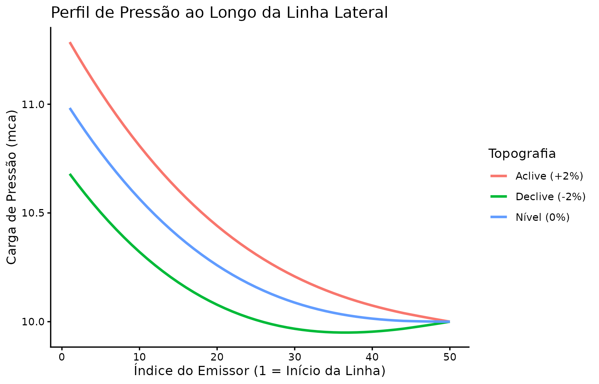

# Perfil de Pressão e Vazão em Linhas Laterais (Método Passo a Passo)

## Introdução

No dimensionamento hidráulico de sistemas de irrigação localizada
(gotejamento e microaspersão), a variação de pressão ao longo da linha
lateral afeta diretamente a uniformidade de distribuição de água. Como a
vazão escoa continuamente pelos emissores ao longo da tubulação, a perda
de carga por atrito não é linear.

A função
[`calc_backstep()`](https://joaobtj.github.io/irritool/reference/calc_backstep.md)
implementa o **método passo a passo** (*backstep procedure*), partindo
da condição de contorno conhecida no último emissor (extremidade distal
da linha) e avançando trecho a trecho em direção à derivação (início da
linha), computando a perda de carga por Darcy-Weisbach via
[`hf::calc_head_loss_darcy()`](https://joaobtj.github.io/hf/reference/calc_head_loss_darcy.html).

``` r

library(irritool)
library(ggplot2)
```

------------------------------------------------------------------------

## 1. Linha Lateral em Nível (`slope = 0`)

Considere uma linha lateral de polietileno com diâmetro interno
$`D = 12\text{ mm}`$ ($`0,012\text{ m}`$), rugosidade absoluta
$`\varepsilon = 1,5 \times 10^{-6}\text{ m}`$, contendo $`50`$
gotejadores espaçados a cada $`0,30\text{ m}`$ ($`L = 15\text{ m}`$).

A relação vazão-pressão do emissor é dada por $`q = k \cdot H^x`$, com
coeficiente
$`k = 8,84 \times 10^{-7}\text{ m}^3\text{ s}^{-1}\text{ mca}^{-x}`$
(equivalente a $`3,18\text{ L h}^{-1}`$ a $`1\text{ mca}`$) e expoente
de descarga $`x = 0,50`$. Deseja-se manter uma pressão mínima no final
da linha igual a $`10\text{ mca}`$:

``` r

perfil_nivel <- calc_backstep(
  end_pressure = 10,
  diameter = 0.012,
  spacing = 0.30,
  n_emitters = 50,
  slope = 0,
  emitter_coef = 8.84e-7,
  emitter_exp = 0.50,
  roughness = 1.5e-6
)

head(perfil_nivel)
#> # A tibble: 6 × 5
#>   emitter pressure_head emitter_flow section_flow head_loss
#>     <int>         <dbl>        <dbl>        <dbl>     <dbl>
#> 1       1          11.0   0.00000293     0.000142    0.0540
#> 2       2          10.9   0.00000292     0.000139    0.0521
#> 3       3          10.9   0.00000292     0.000136    0.0501
#> 4       4          10.8   0.00000291     0.000133    0.0482
#> 5       5          10.8   0.00000290     0.000130    0.0463
#> 6       6          10.7   0.00000290     0.000127    0.0445
tail(perfil_nivel)
#> # A tibble: 6 × 5
#>   emitter pressure_head emitter_flow section_flow head_loss
#>     <int>         <dbl>        <dbl>        <dbl>     <dbl>
#> 1      45          10.0   0.00000280   0.0000168   0.000843
#> 2      46          10.0   0.00000280   0.0000140   0.000675
#> 3      47          10.0   0.00000280   0.0000112   0.000506
#> 4      48          10.0   0.00000280   0.00000839  0.000337
#> 5      49          10.0   0.00000280   0.00000559  0.000169
#> 6      50          10     0.00000280   0.00000280  0
```

A vazão total requerida na entrada da linha lateral (`section_flow` no
emissor 1) e a pressão de serviço necessária no início da linha
(`pressure_head` no emissor 1) são obtidas diretamente da primeira linha
do tibble retornado:

``` r

# Pressão requerida na entrada da linha lateral (mca)
perfil_nivel$pressure_head[1]
#> [1] 10.98282

# Vazão total na entrada da linha lateral (L/h)
perfil_nivel$section_flow[1] * 3.6e6
#> [1] 509.8596
```

------------------------------------------------------------------------

## 2. Efeito da Declividade do Terreno (`slope`)

O argumento `slope` representa a declividade em $`\text{m m}^{-1}`$: \*
Valores **positivos** (`slope > 0`) indicam terreno em aclive (subida no
sentido do escoamento). \* Valores **negativos** (`slope < 0`) indicam
terreno em declive (descida no sentido do escoamento).

Abaixo comparamos a distribuição de carga de pressão ao longo da mesma
linha lateral sob três condições topográficas: nível ($`0\%`$), aclive
($`+2\%`$) e declive ($`-2\%`$):

``` r

perfil_aclive <- calc_backstep(
  end_pressure = 10,
  diameter = 0.012,
  spacing = 0.30,
  n_emitters = 50,
  slope = 0.02,
  emitter_coef = 8.84e-7,
  emitter_exp = 0.50,
  roughness = 1.5e-6
)

perfil_declive <- calc_backstep(
  end_pressure = 10,
  diameter = 0.012,
  spacing = 0.30,
  n_emitters = 50,
  slope = -0.02,
  emitter_coef = 8.84e-7,
  emitter_exp = 0.50,
  roughness = 1.5e-6
)

dados_comparacao <- rbind(
  cbind(perfil_nivel, cenario = "Nível (0%)"),
  cbind(perfil_aclive, cenario = "Aclive (+2%)"),
  cbind(perfil_declive, cenario = "Declive (-2%)")
)

ggplot(dados_comparacao, aes(x = emitter, y = pressure_head, color = cenario)) +
  geom_line(linewidth = 1) +
  labs(
    title = "Perfil de Pressão ao Longo da Linha Lateral",
    x = "Índice do Emissor (1 = Início da Linha)",
    y = "Carga de Pressão (mca)",
    color = "Topografia"
  ) +
  theme_classic()
```


